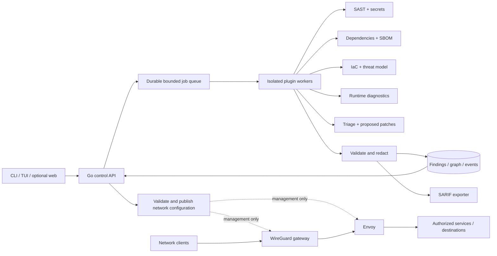

# Architecture

## Scope and decisions

Build one local CLI and daemon first, with optional TUI and web clients. Support Windows, Linux, and macOS for orchestration. Use Linux gateways for the initial production network deployment. Native runtime inspection and VPN integration require separate adapters and acceptance tests on each operating system.

The five analysis engines are independent processes. A sixth networking subsystem configures established proxies and VPN implementations. It does not route packets through the orchestrator, database, scanners, or an LLM.

| Component | Decision | Reason and constraint |
| --- | --- | --- |
| CLI, daemon, scheduler, adapters | Go with a pinned supported stable toolchain at implementation time | One deployable binary, cancellation with contexts, bounded goroutines, cross-platform builds. Do not introduce a Python orchestration service as well. |
| Plugin RPC | Protobuf v3 and gRPC streaming | One versioned contract, generated clients, deadlines and transport flow control. Bound application queues too. |
| Local persistence | SQLite in WAL mode, one writer | Store jobs, findings and graph edges without another service. Never place WAL storage on a shared network filesystem. |
| Multi-user deployment | PostgreSQL when required | Tenant isolation, transactions and distributed job leases. Defer Redis and Kafka until queue measurements justify them. |
| Web client | TypeScript and React; HTTP API plus SSE | Optional client, paginated findings and incremental job progress. No browser access to plugin endpoints. |
| TUI | Go terminal client | Share API and domain contracts with CLI. Rendering must never own scan execution. |
| SAST and secrets | Semgrep adapter plus bounded regex and entropy checks | Use tested parsers. Match precision and language support must be measured on fixtures. Entropy is a heuristic, not proof of a credential. |
| Dependency analysis | OSV API adapter and CycloneDX exporter, optional Trivy | Reuse advisory data and container analysis. Preserve exact package versions, ecosystems and dependency relationships. |
| IaC | Checkov adapter; OPA for organization policies | Normalize results rather than reimplement every Terraform or Kubernetes rule. |
| Runtime | OpenTelemetry Collector plus OS-specific process inspection | Reuse telemetry reception and export. Linux eBPF is an optional privileged collector, never a cross-platform promise. |
| Reverse and forward proxy | Envoy, separately configured listeners | Mature connection handling, limits and overload protection. Forward proxy requires identity and destination policy. |
| VPN | Official WireGuard implementations | Existing protocol and platform integrations. Go manages configuration, not per-packet encryption. |

External engines need pinned versions, checksum verification, license review, and compatibility fixtures before distribution. They remain optional executables; a missing engine produces an explicit unavailable status.

## Process and trust boundaries



The network arrows show one optional deployment, not a requirement to chain every connection through both WireGuard and Envoy. Private service access can use WireGuard directly; public ingress uses a reverse proxy; application egress can use a forward proxy.

The daemon uses local OS access controls. Remote administration uses authenticated TLS with per-project authorization. Plugin processes receive short-lived credentials scoped to one run. A plugin being local does not make it trusted. Process separation is fault isolation; filesystem and network sandboxing need platform enforcement.

## Planned monorepo

Only README.md, this document, plugin-protocol.md and plugin.proto are delivered in Step 1. The following is the complete proposed implementation layout; absent folders are planned, not implemented.

```text
Gods-eye/
  README.md
  go.mod
  go.sum
  cmd/
    godseye/main.go                 # CLI / optional TUI
    godseyed/main.go                # local control daemon
    godseye-plugin/main.go          # adapter host
  api/godseye/v1/plugin.proto       # canonical domain and RPC contract
  gen/go/godseye/v1/                # generated Go bindings
  internal/
    domain/                        # validated findings and event types
    api/                           # authenticated HTTP/SSE API
    orchestrator/                  # planning, dispatch, cancellation
    scheduler/                     # admission, leases, retries, quotas
    registry/                      # plugin manifests and handshakes
    transport/                     # authenticated gRPC adapters
    workspace/                     # immutable input snapshot and exclusions
    store/                         # repositories, SQLite migrations
    graph/                         # typed nodes, edges, evidence and provenance
    triage/                        # deduplication and explainable ranking
    redact/                        # evidence and diagnostic redaction
    report/sarif/                  # shared SARIF 2.1.0 conversion
    network/                       # config generation and rollout, no packets
    platform/{linux,windows,darwin}/
  plugins/
    sast/                          # Semgrep and secret rules
    sca/                           # lockfiles, OSV cache, SBOM
    iac/                           # Checkov, OPA, STRIDE graph
    runtime/                       # process diagnostics and OTel correlation
    remediation/                   # patch proposal and isolated verification
  rules/{sast,secrets,iac}/         # versioned declarative policies
  apps/web/                        # React/TypeScript optional dashboard
  sdk/{go,python}/                 # plugin author helpers when needed
  configs/
    plugins/                       # explicitly installed executable manifests
    envoy/                         # ingress and authenticated egress templates
    wireguard/                     # templates without private keys
    otel/                          # local-only redaction/export defaults
  deploy/{local,linux-gateway}/
  docs/
    architecture.md
    plugin-protocol.md
    operations.md
    threat-model.md
  tests/{contracts,integration,fixtures,network,benchmarks}/
  scripts/                         # generation and reproducible verification
  .github/workflows/               # checks and release provenance
```

The braces in the tree abbreviate sibling directories.

## Execution and robustness

Persist a run before acknowledging submission. Its immutable input snapshot includes a commit or content digest, rule versions, tool versions, exclusions and advisory-cache age. Respect ignored files by default and record coverage omissions. Never execute repository build scripts just to scan dependencies.

Jobs transition through queued, running and one terminal state: succeeded, partial, failed or cancelled. Cancellation first stops admission, then cancels RPCs, then terminates the entire worker process tree after a grace period. Outputs already accepted remain tagged with the terminal run status.

Start with two concurrent scan workers and a queue of 32 jobs per local installation. Return a retryable capacity error when full. These are conservative defaults, configurable after measurement. Give every job wall-clock, memory, file-count, file-size, output-size and subprocess limits. Reserve CPU and memory for networking; on shared Linux hosts enforce worker cgroups and I/O limits. On Windows use Job Objects. Do not treat Go context cancellation as an OS resource limit.

Use leases and heartbeats for recovery. Expired jobs become interrupted; retry in a new run attempt with the same immutable snapshot. Delivery is at least once. Deduplicate accepted output by run attempt and sequence, then deduplicate findings by stable fingerprint. Never claim exactly-once external tool execution.

Use per-plugin queues so a slow engine does not monopolize workers. Stream validated output in bounded batches, persist before acknowledging final completion, and expose dropped diagnostic counts. A crashed or invalid plugin marks its job partial or failed; an empty successful result must never substitute for a failed scan.

Cache parse results by content digest plus parser and rule versions. Cache advisory responses with retrieval time and expiry; offline results are visibly stale. Cancel superseded interactive requests. Defer cross-file incremental taint analysis until correctness tests prove dependencies invalidate the right cached results.

## Network design

### Reverse proxy

Terminate TLS at Envoy only where inspection is intended; use validated TLS or mTLS to upstream services. Configure explicit hostnames and routes, header and body limits, upstream connection pools, HTTP/2 where useful, connect/request/idle deadlines and per-identity rate limits. Streaming and WebSocket routes need separate idle policies.

Strip untrusted forwarded headers at the first trusted edge and reconstruct them from the authenticated connection. Only trust configured upstream proxies. Never trust arbitrary X-Forwarded-For for identity or authorization. Restrict direct origin access through firewall policy.

Use health checks, bounded pending requests, circuit breakers and overload shedding. Retry only requests known to be idempotent, under a retry budget and within the original deadline. Do not automatically retry non-idempotent writes. Keep a last known good configuration and use drain periods during replacement.

### Forward proxy

Expose an authenticated HTTPS CONNECT listener only to enrolled clients. Reject unauthenticated access. Restrict destination ports, names and resolved IP ranges per policy. Deny loopback, link-local metadata, private and reserved addresses unless a named private-service policy explicitly permits them. Apply rules to IPv4 and IPv6, validate every resolution, and pin the approved address for the connection to prevent DNS rebinding.

CONNECT carries end-to-end TLS without interception. The proxy still knows the client and destination, and sees timing and volume. Do not add transparent TLS interception as a privacy feature. Raw UDP applications use the VPN; the initial CONNECT mode covers TCP only.

### VPN

Use WireGuard with individual peer keys, restricted routes and revocation. Store private keys using OS secret facilities, outside repository files and application logs. Provision gateways with least-privilege firewall rules, explicit forwarding and no exposed management API.

Offer separate full-tunnel and named split-tunnel profiles. Full-tunnel mode must route both IPv4 and IPv6, or block the unsupported family. Route DNS through the tunnel and enforce a platform firewall kill switch before bringing it up. Permit only the minimal gateway/bootstrap and local-management exceptions. Keep the block active on crash, reconnect and resume until explicit disconnect policy restores ordinary routing. Test DHCP changes, IPv6, roaming and captive portal behavior.

Set MTU from path testing; never hardcode a claimed universally optimal MTU. Prefer kernel-supported WireGuard where available and measure each platform. WireGuard does not provide TCP tunneling; do not silently wrap it in TCP when UDP is blocked. Report the unsupported network and offer an explicit alternative profile later.

Keep the network path working on the last valid configuration during control-plane outages. On policy expiry, deny new authenticated sessions according to the deployment's specified grace period. Full-tunnel privacy rules remain fail-closed. A gateway restart may drop active flows; high availability does not imply seamless connection migration.

## Privacy model

| Observer | Exposure that remains | Design response |
| --- | --- | --- |
| Local ISP or Wi-Fi operator | Gateway address, timing, traffic volume | VPN encryption hides tunneled contents, not the existence of a tunnel. |
| VPN or forward-proxy operator | Client address, egress destinations and timing | Minimize retention; end-to-end TLS protects payloads from ordinary forwarding. Operator trust remains. |
| Destination service | Egress address, accounts, cookies, browser fingerprint, submitted data | Shared egress can hide the access IP. Account and browser identity require separate controls. |
| Reverse-proxy operator | Client metadata and plaintext where TLS terminates | Limit access and logs; use passthrough when application inspection is unnecessary. |
| Observer watching both ends | Correlated timing and packet volume | No universal anonymity claim. Tor also has traffic-correlation limitations. |
| Compromised client or gateway | Keys, endpoint content or local activity | Tunnel encryption cannot fix endpoint compromise. |

Do not combine every mode into a single chain by default. More hops add latency and more operators to trust. An optional Tor profile can be considered for compatible TCP workloads with a separate browser identity model; it is outside the initial fast VPN deployment and has no anonymity guarantee.

Default to local aggregate counters. Exclude packet payloads, authorization headers, cookies, query strings and raw secret matches from telemetry. Disable persistent per-connection access logs in the privacy profile. Keep minimal administrative audit records, such as policy version and action, with explicit retention and access control. A local debugger can deliberately capture sensitive data, so require a scoped diagnostic session with a visible expiry and deletion policy.

Even salted correlation identifiers are pseudonymous data, not anonymous data. Tenant-keyed HMAC identifiers can reduce accidental cross-tenant linkage; keep keys outside the findings database. Advisory queries may disclose dependency names and versions; provide a documented offline-cache mode.

## Analysis and remediation behavior

SAST records source-to-sink evidence and distinguishes syntactic matches from proven data flow. Memory leaks, races and deadlocks need language-specific or runtime evidence; do not label a heuristic as proof. Secret values are redacted before crossing the plugin boundary and never included in fingerprints.

SCA retains package URLs, exact resolved versions, advisory identifiers and dependency edges. Generate CycloneDX initially and add SPDX through a separate exporter. Record unknown versions rather than inventing them. Reachability has explicit unknown, reachable and unreachable states; lack of a call-graph edge is not proof of unreachability. Handle generated code, reflection and dynamic imports conservatively.

IaC builds nodes for services, data stores, identities and trust boundaries. Edges carry the source configuration and whether connectivity is declared or inferred. STRIDE labels describe threats, not discovered exploits. Render escaped Mermaid labels with strict rendering settings; never execute text from repository files.

Runtime correlations use process identity including its start time to avoid PID reuse, UTC timestamps, monotonic ordering within an agent, trace/span IDs where available and clock uncertainty. Repeated samples can suggest a leak or deadlock; one high RSS sample does not prove either. Report unavailable OS capabilities and permission failures explicitly.

Triage merges duplicates while preserving all observations. Rank with severity, confidence, evidence-backed reachability, asset exposure, CVSS and dated EPSS where available. Missing EPSS is unknown, not zero. Show the contributing factors; do not present an arbitrary combined score as an official CVSS value.

Patch proposals include base content hashes, affected paths and a unified diff. Never apply a patch to a different base. Verify proposals in an isolated copy with no production credentials, then offer review. Models may help explain results but never control the traffic path or execute instructions embedded in scanned source. Automatic remediation cannot change firewall, VPN or IAM policy without an explicit deployment action.

## Performance acceptance plan

These are initial engineering targets. They are not promises or benchmark results. Use a Linux gateway with 4 vCPU, 8 GiB RAM and a 1 Gbps interface as the first reference environment; record CPU model, OS, tool versions, RTT, MTU, TLS mode and workload for every result.

| Area | Initial acceptance target | Measurement |
| --- | --- | --- |
| Reverse proxy | Added p99 latency below 5 ms at 1,000 requests/sec for 1 KiB responses and 100 reused connections | Compare direct and proxied same-host upstream under identical TLS, with an open-loop load generator. Report errors and p50/p95/p99. |
| VPN | At least 80% of direct-path TCP goodput on the reference link | Compare the same path with and without the tunnel across several flow counts; report UDP loss, CPU and MTU too. |
| Control API | p95 below 100 ms for paginated reads at 20 requests/sec | Seed 100,000 findings, then test during concurrent scanning. |
| Scheduler | Job submission p95 below 100 ms with queue capacity available | Include durable enqueue; measure overload rejection separately. |
| Resource isolation | Proxy p99 stays within the 5 ms budget during two active scan jobs | Enforce scan limits and compare loaded and idle distributions. |
| Cancellation | Worker process tree stopped within 5 seconds | Test a hung scanner and verify descendants terminate. |

Run at least five measured trials after warm-up; publish raw output and spread. Track requests that time out or fail, rather than excluding them from latency summaries. Also test slow upstreams, connection storms, disk full, full queues, scanner crashes, daemon restarts, database locks and revoked VPN peers. Do not optimize allocations or introduce kernel bypass until profiles show the bottleneck.

## Implementation order and release gates

1. Compile contracts, generate Go bindings, implement validators and fixtures. Build a bounded local scheduler with a fixture plugin, durable runs, cancellation and SARIF export. Gate on crash recovery and invalid-output rejection.
2. Add SAST/secrets and OSV/SBOM adapters. Gate on vulnerable and benign fixtures, offline behavior, redaction and truthful coverage reporting.
3. Add IaC graph and runtime diagnostics, then triage and patch proposals. Gate on provenance, permission failures, PID reuse, and patch base validation.
4. Deploy authenticated Envoy and WireGuard in a private test environment. Gate on DNS/IPv6 leak tests, kill-switch crash tests, open-proxy denial, certificate validation, rollback and the performance suite.
5. Add the optional TUI/web clients and multi-user storage only after core workflows work. Gate on per-project access controls and isolation across tenants.

## Primary references

- [SARIF 2.1.0 specification](https://docs.oasis-open.org/sarif/sarif/v2.1.0/os/sarif-v2.1.0-os.html) defines the report format; raw telemetry remains in its own schema.
- [OSV batch query API](https://google.github.io/osv.dev/post-v1-querybatch/) supports dependency advisory lookup; adapters must also handle pagination and fetch full advisory records as needed.
- [OpenTelemetry components](https://opentelemetry.io/docs/concepts/components/) describes the Collector's receive/process/export model.
- [Envoy overload manager](https://www.envoyproxy.io/docs/envoy/latest/configuration/operations/overload_manager/overload_manager) and [circuit breaking](https://www.envoyproxy.io/docs/envoy/latest/intro/arch_overview/upstream/circuit_breaking) address resource overload and upstream protection separately.
- [WireGuard protocol](https://www.wireguard.com/protocol/) and [known limitations](https://www.wireguard.com/known-limitations/) inform the tunnel choice and UDP-only transport boundary.
- [Tor's remaining attacks](https://support.torproject.org/about-tor/security/attacks-on-onion-routing/) explains why traffic correlation prevents a universal anonymity guarantee.
