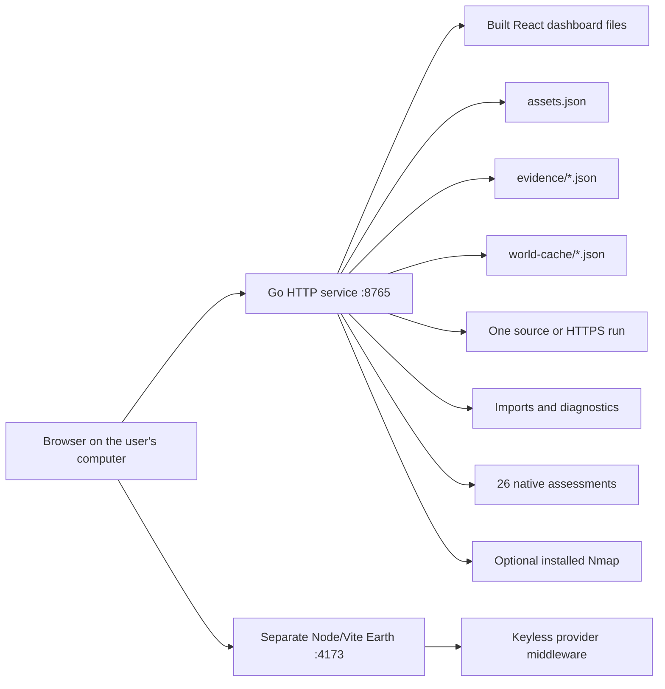

# Current system analysis

Baseline: `4d27de83ad087703b197432ccbf2870a5ea6164c`, 18 October 2026. This document describes source behavior. A listener already running on a local port may be an older build.

## Current runtime

The compiled CLI supports `version`, `scan`, `serve`, and eight `lab` subcommands. The server serves the React build and HTTP API on one origin. It binds `127.0.0.1`; it is a trusted local-user application. The launcher separately starts Earth with Vite preview and registered provider middleware. Serving Earth's `dist` as static files alone would lose those middleware-backed features.

The deployed architecture is smaller than [the original architecture blueprint](../docs/architecture.md). SQLite, PostgreSQL, plugin gRPC execution, SSE, a VPN and Envoy are design choices in that blueprint, not the current backend's implemented services. Current state is JSON plus memory, and the browser polls HTTP.

## Implemented responsibilities

| Area | Current source | Behavior that must survive |
| --- | --- | --- |
| Command entry | `cmd/godseye/main.go`, `lab.go`, `serve.go` | Flags, defaults, exit codes, reports, signal handling and no overwrite |
| Dashboard | `internal/dashboard/server.go` | Inventory, source/HTTPS runs, status, cancellation, exports, static files, request guards |
| Dashboard storage | `internal/dashboard/store.go` | Validated atomic inventory writes and reload |
| Evidence endpoints | `internal/dashboard/workbench.go`, `tool_assessment.go` | Raw uploads, JSON assessments, two independent admission limits and saved reports |
| Secret scanner | `internal/secrets/scan.go`, `rules.go` | Three exact credential rules, redacted findings, budgets, exclusions, deterministic identities |
| Scan export | `internal/report/report.go` | ProtoJSON envelope and source-only SARIF 2.1.0 |
| HTTPS check | `internal/webcheck/check.go` | One public HTTPS HEAD response, verified TLS and header review |
| Evidence normalization | `internal/workbench/model.go`, `store.go` | Reports, graph, content hash, finding IDs, text cleaning and retention |
| Importers | `internal/workbench/import*.go` | 14 supported format IDs, validation, selective extraction and redaction |
| Local analysis | `files.go`, `capture.go`, `policy.go` | File identification/recovery ranges, classic PCAP, static IAM review |
| Diagnostics | `diagnostics.go`, `tool_transport.go` | DNS, TCP and bounded assessment GET requests with distinct address policies |
| Assessments | `tool_audit.go`, `tool_*.go` | All 26 dispatchable modules, their limits and capability metadata |
| Installed engine | `tool_engine.go`, `tool_nmap.go` | Explicit optional Nmap path and pinned fixed arguments |
| Compact World view | `internal/world/feeds.go` | Four fixed upstream feeds, disk cache, freshness, cooldown and stale results |
| Shared schema | `api/godseye/v1/plugin.proto`, `gen/go/...` | Field numbers, optional presence, enum and timestamp semantics used by scan exports |

## Current storage and identity

- `.godseye/assets.json` is inventory. The maximum is 200 assets and a 1 MiB saved file. Text field limits are byte limits in Go, not Python character counts.
- `.godseye/evidence/<id>.json` stores normalized workbench reports. The server retains the newest 20. Opening a store first validates matching report files, refuses more than 100, sorts by timestamp and trims to 20. An implementation that reads just the first 20 would hide corruption or discard the wrong evidence.
- Matching evidence filenames use 26 ASCII alphanumeric characters. Keep compatible IDs and the filename validator. Do not replace these with UUID filenames without changing the compatibility contract.
- Dashboard run history is memory-only, newest first, capped at 20. These runs are distinct from persisted evidence reports. The migration must not promise to resume or recover jobs that the old server never persisted.
- `.godseye/world-cache/<layer>.json` stores last-good feed snapshots. Invalid entries are ignored. Inventory/evidence corruption instead prevents startup. Preserve this difference.
- Browser storage holds map pins, saved views and preferences. Original upload bytes are retained by the browser for recovery slices and are not saved in evidence reports.
- Secret scan run/finding IDs are UUIDs. Their stable fingerprints are hashes of a serialized tuple of version, project, rule, path and match ordinal. Workbench finding and graph IDs use different digest formulas. Treat these as separate contracts.

Current startup normally uses state relative to the launch directory. Verification reports also describe separate local state directories and alternate ports. The migration must inventory configured state locations without logging their contents, and switch an explicitly selected installation rather than assuming every instance uses root `.godseye`.

## Concurrency, lifetime and cancellation

There are three independent operation groups:

1. Dashboard checks allow one run in `running` or `cancelling`. A second request receives HTTP 409. The job has a 30-second parent deadline and is owned by the application, so returning HTTP 202 does not cancel it.
2. Imports, file analysis and basic diagnostics share two admission slots. A third is rejected immediately with HTTP 429. Handler contexts have a 12-second deadline, although synchronous parsers do not all check it internally.
3. Tool assessments have a separate pair of slots and a 45-second deadline. Individual modules add shorter deadlines and work limits.

The scanner normally uses two file workers. TCP diagnostics use four network workers. Feed acquisition is coalesced per layer, not under a server-wide lock. Network writes and slow downloads must not hold the state mutex. A Python design that runs a parser directly in an async route, or starts several Uvicorn processes with separate state, would change these properties.

Cancellation is cooperative in the existing source; it does not establish a complete OS resource sandbox. The replacement should give synchronous work a supervised lifetime and must never claim a Python thread has stopped just because its awaiter was cancelled.

## Security behavior depends on the operation

The same address policy cannot be used everywhere:

| Operation | Existing intent |
| --- | --- |
| Dashboard HTTPS HEAD | Public HTTPS, port 443, no credentials/query/fragment, reject private/local/reserved DNS results |
| Basic TCP and assessment HTTP/TCP | Explicit local/private/loopback targets permitted; reject selected special-purpose and metadata destinations |
| Passive recon TLS collection | Public-address policy, verified certificate names, no visiting discovered names |
| World feeds | Fixed allowlisted URLs only; the caller selects a layer ID, not a destination URL |

Network transports resolve first, validate the returned addresses, and dial validated IPs without a second DNS lookup. TLS still needs the original hostname. Mixed allowed/disallowed DNS results are not silently filtered into an allowed subset. Redirects are not followed.

HTTP middleware requires the configured Host including port, checks Origin when present, rejects `Sec-Fetch-Site: cross-site`, and requires `X-GodsEye-Request: 1` for methods other than GET/HEAD. It adds CSP, no-store, nosniff and no-referrer headers. These controls need parity before making the API functional.

`os.Root` confines scan file opens. A Python `Path.resolve()` check followed by a normal open is weaker under path replacement. Windows reparse points and Linux symlinks require a proved platform implementation.

## Current assessments are richer than older docs suggest

`catalog.go` contains older descriptions but overwrites matching coverage/limits from `toolAssessments`. Use the effective runtime capability list and actual dispatch implementation as the baseline. For example, current Skipfish assessment performs a small crawl; Wireshark assessment accepts PCAPNG; Foremost assessment performs structural validation. Their older generic workflows remain separately callable and have different behavior.

The installed-engine helper allowlists `nmap`, `tshark` and `foremost`, but only Nmap is currently advertised and dispatched as an installed assessment engine. Do not accidentally expose execution for the other two while porting the helper.

## What must not be confused with existing functionality

The current backend does not provide full external Nmap/Nuclei/Burp/Metasploit suites, live packet capture, radio operations, authenticated application testing, broad taint analysis, CVE/SBOM engines, live cloud/directory collection or a production VPN. Keep the original Protobuf/plugin design for future use without inventing operating services during migration.

Earth provider code and browser recipes are JavaScript, not Go backend responsibilities. Their existing behavior must be tested across cutover, but rewriting them is unnecessary for replacing Go.

## Known issues and evidence quality

[The earlier live audit](../docs/live-scenario-audit-2026-10-18.md) found stale-server compatibility, DNS completion flags and missing HTTPS summary counts. Current source and [the later assessment verification](../docs/assessment-verification-2026-10-18.md) include corrections. Preserve the corrected capability handshake, `reviewCount` and DNS `limited` handling. Do not use the older report as the final behavior specification.

Historical checks passed on Windows and Linux cross-builds. The historical reports explicitly leave Linux runtime, race detection and live installed-engine execution unverified. This analysis does not close those gaps. The Python release needs its own runtime evidence on Windows and Linux.

## Risk register

| Risk | Likelihood without focused work | Impact | Cheapest early proof |
| --- | --- | --- | --- |
| Go JSON versus Python defaults/coercion | High | Existing UI/report readers break or invalid input becomes accepted | Captured route fixtures and frontend Zod parsing |
| Byte regex/path/digest mismatch | High | Findings move, IDs change or candidates disappear | Unicode filenames and fixed fingerprint vectors |
| Windows root confinement | High | Out-of-root file reads or lost scan coverage | Real junction/reparse fixtures before scanner port |
| Cancelling only a Python awaiter | High | Continued work, stale writes and admission leaks | Blocked worker then cancel/timeout/re-admit test |
| Docker loopback/volume changes | High | Host services become unreachable; wrong files scanned | Same host/fixture native and container comparison |
| DNS/TLS differences | Medium | Target restrictions bypassed or TLS observations lost | Custom resolver, mixed DNS and real TLS fixtures |
| JSON state changed too early | Medium | Evidence loss and unsafe rollback | Read legacy copies, re-open both ways, checksum comparison |
| Stale backend paired with current UI | Medium | Workbench fails after launch | Required capabilities plus build identity handshake |
| Python CPU overhead | Workload dependent | Slow scans or UI stalls | Measured representative fixtures while polling health/state |
| Treating historical tests as current proof | High | Release accepted without parity | New release evidence ledger with command, build and outcome |
