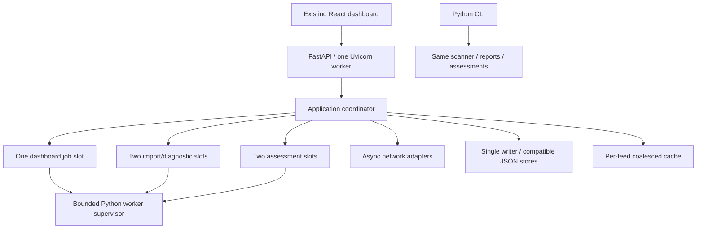

# Proposed Python architecture

Status: proposed target, not implemented. Preserve the current local product contract before adding infrastructure.

## Stack and package boundaries

| Choice | Purpose and reason |
| --- | --- |
| Python 3.13, exact supported patch locked during setup | Matches the currently available local interpreter family and provides modern asyncio. It is a chosen baseline, not a claim to be the newest release. Validate all dependencies on Windows and Linux before locking. |
| FastAPI, Pydantic v2, Uvicorn | HTTP routing, explicit boundary models and one application lifecycle. Keep business logic outside route functions. |
| `argparse`, console entry point `godseye` | Preserve the existing CLI without bringing a second command framework into the first port. Add a Go-compatible flag/duration parsing adapter where required. |
| `aiohttp` | Outbound async HTTP with custom DNS resolution, streaming byte limits, explicit redirect policy and original-host TLS. Proof of policy equivalence is required before adoption. |
| `asyncio` sockets and a DNS adapter | TCP probes, deadlines, DNS records and cancellable network work. Evaluate dnspython for record queries, with OS resolver configuration compatibility tests. |
| Standard `hashlib`, `base64`, `struct`, `csv`, `ssl` | Hashes, encodings, byte formats and TLS. Avoid large security-suite dependencies for already bounded algorithms. |
| `protobuf` and build-only generation tooling | Generate Python types from the unchanged `.proto` and preserve ProtoJSON. The live HTTP product does not need a new gRPC server. |
| `defusedxml` | Explicitly bounded XML parsing without external entity/network resolution. Confirm accepted legacy fixtures, since safer parser rejection can be stricter. |
| `cryptography` | Public X.509 inspection and a TLS verification compatibility spike. Do not add JWT signature/key fetching that current inspection does not perform. |
| pytest, async test support, Hypothesis, Ruff and a type checker | Behavior tests, malformed binary/parser inputs, formatting/lint and type checks. Keep exact versions in the development lock. |

Resolve concrete versions and transitive dependencies together. Record license notices and reproducible installation commands. Avoid taking versions from unrelated projects or calling untested package combinations production-ready.

## Proposed tree

```text
backend/
  pyproject.toml
  requirements.lock
  requirements-dev.lock
  src/godseye/
    __main__.py
    cli.py
    config.py
    application.py
    api/
      app.py
      middleware.py
      errors.py
      assets.py
      runs.py
      lab.py
      world.py
      static.py
    contracts/
      dashboard.py
      evidence.py
      requests.py
      scan_export.py
      generated/godseye/v1/plugin_pb2.py
    jobs/
      coordinator.py
      supervisor.py
      worker.py
      cancellation.py
    scanning/
      scanner.py
      rules.py
      fingerprints.py
      filesystem.py
      filesystem_posix.py
      filesystem_windows.py
    reports/
      scan_json.py
      sarif.py
      evidence.py
    storage/
      inventory.py
      evidence.py
      world_cache.py
      atomic_files.py
      instance_lock.py
    network/
      address_policy.py
      resolution.py
      http.py
      tls.py
      tcp.py
      dns.py
    workbench/
      catalog.py
      dispatch.py
      importers/{json,xml,csv}.py
      files.py
      capture.py
      iam.py
      assessments/          # one module per existing tool ID
      engines.py
    world/feeds.py
  tests/
    unit/
    contracts/
    integration/
    parity/
    fixtures/
deploy/
  Dockerfile.backend
  compose.yaml
  .dockerignore
documentation/
```

This is a responsibility map. Do not create empty layers or one-line forwarding modules just to match the tree. Group code when it has one owner and split it when contracts, I/O and domain decisions diverge. Existing `api/`, `apps/web`, `apps/earth` and `docs` remain in place during implementation.

## Process ownership



One application lifecycle creates validated configuration, stores, admission controllers, HTTP sessions, worker supervisor and clocks. Routes and CLI construct domain requests and call the same implementations. Workers do not mutate the coordinator's live dictionaries or write inventory/evidence directly. The parent validates returned output and commits it.

Use one Uvicorn process throughout this migration. Multiple API workers would independently admit jobs and own divergent memory and JSON stores. A machine-local instance lock tied to the configured writable state directory prevents two processes from writing one store. Several installations may operate with different ports and state directories. A production multi-user scheduler/database can be designed later.

FastAPI documents async I/O separately from CPU parallelism, and worker deployment is explicitly multi-process. These choices follow the current application's ownership requirements. [Async behavior](https://fastapi.tiangolo.com/async/), [server workers](https://fastapi.tiangolo.com/deployment/server-workers/).

## Work execution and admission

Keep the existing three independent groups. Admission must use an atomic non-waiting operation; a semaphore that queues the third HTTP request changes today's immediate 429 behavior. Keep small in-memory state critical sections, and serialize JSON disk mutations without holding the state lock while sending a response.

Network-oriented modules run asynchronously with explicit per-operation budgets. CPU-heavy binary parsing, large JSON/XML normalization, hashing loops and the scanner run in supervised spawned Python child processes. Start with a bounded supervisor capacity of five child jobs, matching the maximum one dashboard plus two lab plus two assessment admissions. Launch lazily, measure memory, and do not silently reduce a group's capacity. In native mode each child initially uses one CPU execution thread; the scanner retains its existing bounded file-worker setting. A child process boundary keeps its GIL work outside the API loop.

Do not rely on `ProcessPoolExecutor.cancel()` or `asyncio.to_thread()` to terminate running computation. Use explicitly owned process handles, bounded IPC, an overall supervisor byte budget, request IDs and a single accepted terminal result. IPC frames must be size-bounded before parent allocation. Never deserialize target-supplied pickle data. Child reports return validated JSON/Protobuf-compatible data and contain no raw secret inputs.

Keep a cooperative cancellation event inside child loops. After a cancellation request, allow up to one second for cooperative exit, then terminate; enforce a five-second total process-tree cleanup ceiling. These are proposed acceptance targets. If existing public status semantics require `cancelling` while cleanup proceeds, keep that state until ownership is actually released. On Windows, use a Job Object or another proved child-tree mechanism; on POSIX, own a separate process group. Include installed Nmap descendants.

Python cancellation raises into the coroutine; it does not automatically undo side effects or stop a thread. Always await cleanup, re-raise cancellation at the correct boundary, and reject late worker results after terminal transition. [Python task cancellation](https://docs.python.org/3.13/library/asyncio-task.html).

## Lifetime model

Dashboard jobs belong to the application after HTTP 202 and survive the creating request's normal completion. Workbench imports and assessments remain request-scoped and synchronous at the API boundary. Do not convert them into queued 202 jobs during the port.

State transitions are `running -> completed|partial|failed`, or `running -> cancelling -> cancelled`. Cancellation/deadline takes precedence at final commit as it does in current dashboard code. Use a generation/run identity check so a late result cannot overwrite terminal state. The scanner's CLI summary can mark interruption partial and exit 3 while the dashboard maps its cancelled context to `cancelled`; preserve both representations.

Application shutdown stops admission, signals active jobs, drains/terminates owned work, closes clients and flushes completed writes. No cross-restart continuation is advertised for memory-only dashboard jobs. This preserves current persistence rather than silently changing it.

## Serialization and boundary validation

Use Pydantic models for HTTP DTOs and frozen domain objects where useful. Set explicit camelCase aliases, forbidden extra fields for request envelopes, strict scalar types and JSON-safe arrays. Preserve existing missing/zero/null handling through compatibility fixtures. A blanket rule that requires every Go struct field is not equivalent: some absent fields currently become empty strings, false, zero or nil and are rejected later only when relevant.

Return legacy HTTP 400 JSON errors instead of FastAPI's default validation 422 body. Do not let exceptions echo input values. Preserve middleware rejection status and body type separately, including plain-text guard failures where observed. Decide framework changes to trailing-slash redirects, HEAD and unknown routes through explicit tests rather than defaults.

Use generated Protobuf Python messages and ProtoJSON for scan finding/summary payloads, with ordinary JSON for dashboard/evidence DTOs. ProtoJSON enum names, 64-bit number strings, optional presence and omitted default fields are observable contracts. [ProtoJSON specification](https://protobuf.dev/programming-guides/json/). Strict validation must be deliberate rather than relying on Pydantic coercion. [Pydantic strict mode](https://pydantic.dev/docs/validation/latest/concepts/strict_mode/).

## Filesystem and network adapters

The filesystem adapter must prove root confinement when opening each directory and file. On POSIX evaluate descriptor-relative opens, no-follow flags and regular-file checks. On Windows prototype handle-based traversal and reparse-point rejection before accepting the platform. Handle closure, case differences, junctions, drive-relative/UNC paths, alternate streams and directory swaps belong in integration fixtures. Simple string prefix checks are invalid. Standard Python OS support is platform dependent. [OS interface reference](https://docs.python.org/3.13/library/os.html).

For outbound HTTP, keep logical host/SNI separate from validated dial IPs. Disable ambient proxy settings and automatic redirects. Avoid shared cookies across targets; the existing Go transports do not establish browser sessions. Bound streamed decoded response bytes, headers and time, including decompression. Test aiohttp's resolver/connector path to prove no second lookup, mixed-address rejection and correct TLS hostname verification. [aiohttp client controls](https://docs.aiohttp.org/en/stable/client_advanced.html).

Nmap native TLS diagnosis currently observes an invalid certificate and reports verification failure. A normal verified HTTP client cannot substitute for that behavior. Prototype equivalent certificate-chain, hostname and validity verification with the selected Python TLS/X.509 stack against real certificate fixtures. Keep this diagnostic path separate from normally verified HTTPS checks. If trust-store equivalence cannot be proved, this blocks acceptance of native Nmap parity. [Python TLS reference](https://docs.python.org/3.13/library/ssl.html).

## Persistence, observability and scope

Keep legacy filenames, report shapes and retention. Atomic writes use a temporary file in the destination directory, flush, fsync, close and replace. Validate path ownership and OS permissions. Reject partial or corrupted required state instead of starting empty. Use backups for migration and a single writer; avoid dual writes to Go and Python state.

Structured logs contain operation ID, module, elapsed time, outcome, limits and redacted error category. Never log uploaded bodies, URLs with credentials/query secrets, candidate passwords, JWTs or child stderr. Child output streams are drained concurrently and bounded. Optional Nmap keeps 8 MiB stdout, 4 KiB stderr and the current timeout hierarchy.

Do not add Redis, Celery, Kafka, Kubernetes, a public reverse proxy or database as prerequisites. Do not add SSE, authentication redesign or a new frontend framework in the parity release. Docker packaging is covered separately.
